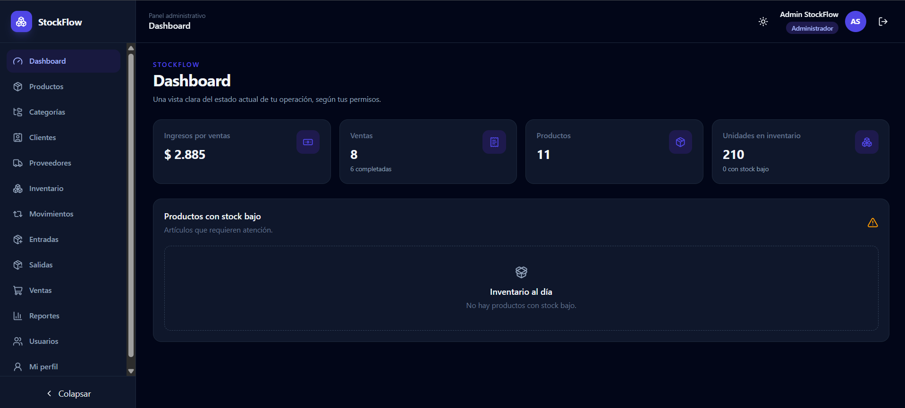
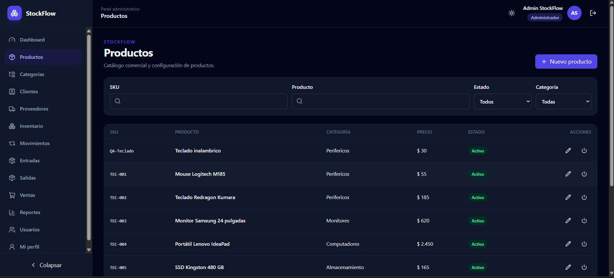
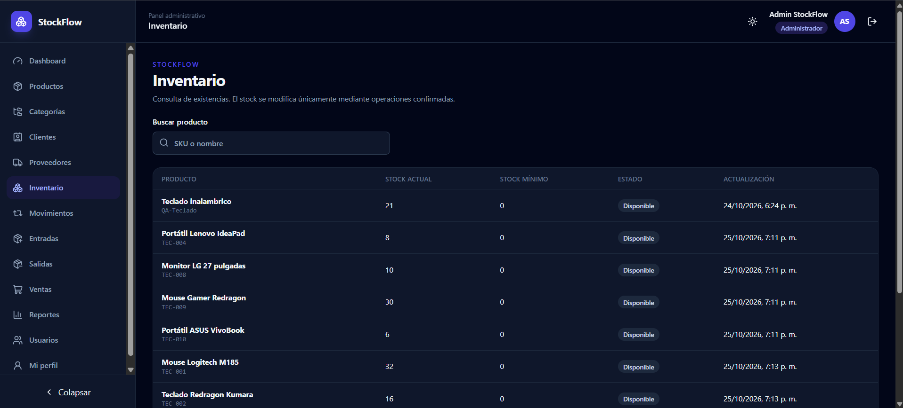
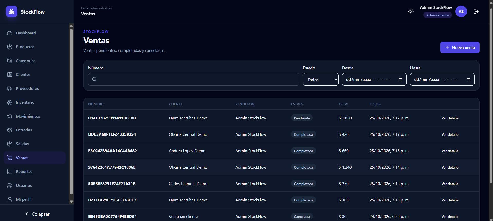
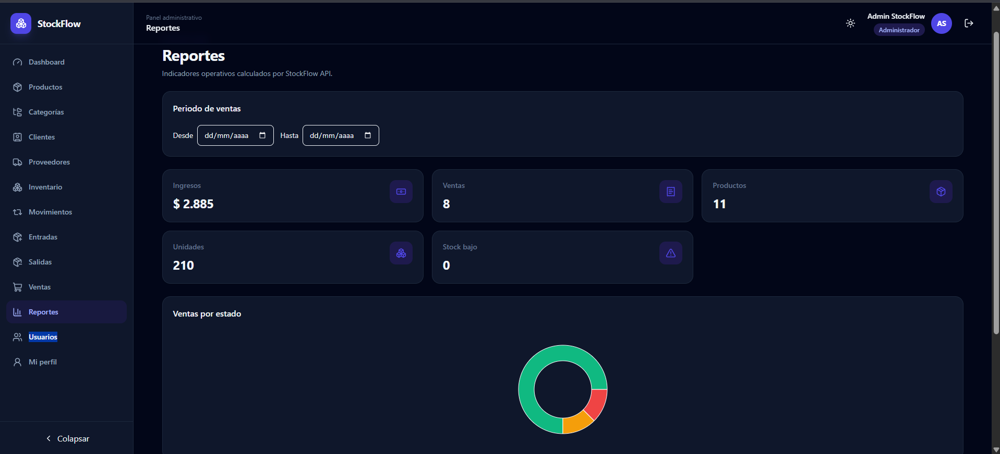

# StockFlow Frontend

## Demo en vivo

**StockFlow es un sistema full-stack de gestión de inventario y ventas**, desarrollado como proyecto de portafolio de ingeniería de software.

🌐 **[Abrir aplicación web](https://stockflow-frontend-sigma.vercel.app/login)**

La aplicación permite administrar productos, categorías,
proveedores, clientes, usuarios, movimientos de inventario,
entradas, salidas y ventas, con autenticación JWT y control
de acceso basado en roles.

### Arquitectura en producción

| Componente | Tecnología | Despliegue |
|---|---|---|
| Frontend | React, TypeScript, Vite | Vercel |
| Backend | Java 21, Spring Boot | Render |
| Base de datos | PostgreSQL | Neon |
| Autenticación | Spring Security, JWT | Backend |
| Migraciones | Flyway | PostgreSQL |

### Repositorios

- [Frontend — React y TypeScript](https://github.com/Mateo1744/stockflow-frontend)
- [Backend — Spring Boot](https://github.com/Mateo1744/stockflow-api)

### Características destacadas

- Gestión de inventario con movimientos trazables.
- Flujo completo de entradas, salidas y ventas.
- Control de stock y alertas de existencias bajas.
- Dashboard y reportes basados en datos reales.
- Autenticación JWT y autorización por roles.
- Formularios validados, filtros, paginación y ordenamiento.
- Interfaz responsive con soporte para tema oscuro.
- Pruebas automatizadas y despliegue mediante GitHub.

> **Nota:** El backend utiliza un servicio gratuito de Render
> que puede necesitar hasta unos 90 segundos para iniciar después de un periodo de inactividad.
> El acceso a la aplicación requiere una cuenta autorizada.

Todos los nombres, productos, clientes y operaciones visibles en la demo son ficticios. La interfaz presenta los importes en **USD** como convención de demostración; el backend conserva valores decimales y no implementa conversión de divisas ni un sistema multimoneda.

## Backend

El backend oficial es [Mateo1744/stockflow-api](https://github.com/Mateo1744/stockflow-api). Su URL se configura en build time mediante `VITE_API_URL`.

## Capturas de pantalla

### Dashboard


### Gestión de productos


### Inventario


### Gestión de ventas


### Reportes


## Stack

- React 19, TypeScript 7 y Vite 8
- React Router, TanStack Query y Axios
- React Hook Form y Zod
- Tailwind CSS 4 y primitivas estilo shadcn/ui
- Lucide React, Recharts y Sonner
- Vitest, Testing Library y jsdom

## Funcionalidades

- Login JWT, sesión persistida, logout, guards y autorización por rol.
- Perfil seguro derivado de la sesión, sin exponer token ni credenciales.
- Gestión de productos, categorías, proveedores, clientes y usuarios según el rol; las eliminaciones disponibles son desactivaciones lógicas para conservar el historial.
- Inventario de solo lectura y trazabilidad de movimientos.
- Entradas y salidas con borrador, confirmación y cancelación.
- Ventas pendientes, completadas o canceladas; la API determina precios y stock.
- Dashboard y reportes reales por rol, incluido filtro temporal soportado por ventas.
- Filtros, paginación, estados de carga/error/vacío, tema oscuro y diseño responsive.

## Roles

- `ADMIN`: administración completa, usuarios y todos los reportes.
- `INVENTORY_MANAGER`: gestión de productos, categorías y proveedores; inventario, movimientos, entradas/salidas, reportes de inventario y lectura de ventas.
- `SELLER`: lectura de productos/categorías, gestión de clientes y ventas, y reporte de ventas.

La interfaz aplica permisos en rutas y acciones, pero cada petición sigue siendo validada por la API.

## Instalación

Requiere Node.js 22+ y una instancia de StockFlow API.

```bash
npm ci
cp .env.example .env
npm run dev
```

En PowerShell: `Copy-Item .env.example .env`.

## Variables

```env
VITE_API_URL=http://localhost:8080
```

No se incluyen JWT, contraseñas ni secretos en variables del frontend. Para desarrollo desde `http://localhost:5173`, el backend debe permitir exactamente ese origen mediante CORS. Para la imagen Docker expuesta en el ejemplo, debe permitir `http://localhost:3000`.

## Scripts y calidad

```bash
npm run dev
npx tsc -b
npm run lint
npm run test
npx vite build --configLoader native
```

El loader nativo se recomienda en Windows cuando Vite devuelve `spawn EPERM`. GitHub Actions ejecuta instalación reproducible, TypeScript, lint, tests y build. La suite verificada contiene **41 tests**.

## Arquitectura

```text
src/
  app/                    providers y rutas lazy
  components/
    layout/               shell administrativo responsive
    shared/               estados, tablas, diálogos y pickers
    ui/                   primitivas visuales
  features/
    auth/ dashboard/ profile/ reports/
    products/ categories/ suppliers/ customers/ users/
    inventory/ inventory-movements/
    stock-entries/ stock-exits/ sales/
  lib/
    api/                  cliente Axios y errores normalizados
    auth/                 sesión y roles encapsulados
    utils/                formatos y utilidades
  types/                  contratos de la API
```

Cada dominio conserva sus API y query keys. TanStack Query invalida únicamente inventario, movimientos, documentos y reportes relacionados después de una operación. Los importes de formularios son ayudas visuales; el backend calcula el valor definitivo.

## Docker

La imagen multi-stage compila con Node 22 y sirve `dist` desde Nginx con fallback SPA y caché inmutable para assets:

```bash
docker build --build-arg VITE_API_URL=http://localhost:8080 -t stockflow-frontend .
docker run --rm -p 3000:80 stockflow-frontend
```

`compose.full-stack.yml` supone que el backend está en `../stockflow-api`. `VITE_API_URL` debe ser una URL accesible por el navegador, no el hostname interno de Docker. Define los secretos y el bootstrap solo en el entorno local:

```powershell
$env:POSTGRES_PASSWORD = '<local-only>'
$env:JWT_SECRET = '<base64-secret-of-at-least-32-bytes>'
$env:STOCKFLOW_BOOTSTRAP_ADMIN_ENABLED = 'true'
$env:STOCKFLOW_BOOTSTRAP_ADMIN_EMAIL = 'admin@example.com'
$env:STOCKFLOW_BOOTSTRAP_ADMIN_PASSWORD = '<local-only>'
$env:STOCKFLOW_BOOTSTRAP_ADMIN_FIRST_NAME = 'Admin'
$env:STOCKFLOW_BOOTSTRAP_ADMIN_LAST_NAME = 'StockFlow'
docker compose -f compose.full-stack.yml config
docker compose -f compose.full-stack.yml up --build -d
docker compose -f compose.full-stack.yml ps
```

Servicios: PostgreSQL con healthcheck, StockFlow API en `:8080` con healthcheck y frontend en `:3000`. El build usa por defecto `VITE_API_URL=http://localhost:8080` y CORS permite `http://localhost:3000`.

## Conexión y decisiones

Axios central usa `VITE_API_URL`, adjunta el token desde storage encapsulado y convierte 401/403/404/409/500/503 en mensajes seguros. Un 401 limpia la sesión. `/profile` usa el usuario de `LoginResponse`; no inventa `/me`.

- Lazy loading por módulo, sin fragmentar componentes pequeños.
- Sin refresh token, proxy permanente ni reglas de negocio duplicadas.
- Los E2E de escritura requieren el entorno full-stack efímero y datos aislados; no se ejecutan contra una base compartida.
- Futuro: refresh token cuando exista contrato, devoluciones/reversiones y despliegue automatizado.
